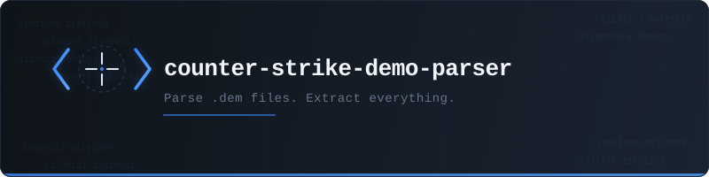

<p align="center">
  
</p>

# counter-strike-demo-parser

> TypeScript CS:GO `.dem` parser. Type-safe, streaming, fast.

[](https://github.com/yarikleto/counter-strike-demo-parser/actions/workflows/ci.yml)
[](./LICENSE)
[](https://nodejs.org)

Parse CS:GO `.dem` files and extract everything: every kill, every entity,
every event. Pure TypeScript, runs in Node and in the browser (Web Workers
included), ESM-first with CJS dual export, no native dependencies.

## Features

- Runs in Node 22+, browsers and Web Workers. The browser build has no Node
  built-ins and takes a `Uint8Array` / `ArrayBuffer`.
- Two API levels: the one-shot `parseDemo()` / `DemoParser.parse()` returning
  plain data, and a fully typed streaming event emitter.
- Results are plain data (objects, arrays, typed arrays): `postMessage` them
  out of a worker, store them in IndexedDB, or `JSON.stringify` them.
- Replay-ready: columnar player positions (with view angles, health, armor,
  money, active weapon), grenade throws, trajectories and effects, bomb events
  with positions and sites, all in world coordinates.
- Progress reporting and cancellation (`onProgress`, `AbortSignal`).
- Bit-identical to [`demoinfocs-golang`](https://github.com/markus-wa/demoinfocs-golang)
  on the cross-validated kill stream (337/337 kills on the `de_nuke` fixture).
- ~120 MB/s parse throughput on Node 22 (Apple M5).
- Defensive parsing: malformed demos surface via the `parserError` event,
  never throw out of the parse loop.

## Install

```bash
npm install counter-strike-demo-parser
```

Node.js 22 or newer, or any modern browser. The package has two builds,
picked automatically through `package.json` `exports` conditions: the Node
build (file paths, streams) under the `node` condition, and the browser
build everywhere else (bundlers targeting the browser, Web Workers, Deno,
Cloudflare Workers). Import `counter-strike-demo-parser/browser` or
`counter-strike-demo-parser/node` to choose explicitly.

## Quickstart (Node)

```typescript
import { parseDemo } from "counter-strike-demo-parser";

const demo = await parseDemo("match.dem"); // path, Buffer, ArrayBuffer or Readable

for (const kill of demo.kills) {
  const tag = kill.headshot ? " (headshot)" : "";
  console.log(`${kill.attacker?.name ?? "world"} -> ${kill.victim.name} [${kill.weapon}]${tag}`);
}
```

## Browser: parse in a Web Worker

Parsing a 150 MB demo takes about a second and a few hundred MB of memory,
so run it in a worker. The worker below is the one the browser smoke test
(`npm run test:browser`) runs in Chrome.

```typescript
// demo-worker.ts
import { parseDemo, positionBuffers } from "counter-strike-demo-parser";

let controller: AbortController | undefined;

self.onmessage = async (event: MessageEvent) => {
  const msg = event.data as { type: "parse"; url: string } | { type: "cancel" };
  if (msg.type === "cancel") return controller?.abort();

  controller = new AbortController();
  try {
    const bytes = new Uint8Array(await (await fetch(msg.url)).arrayBuffer());
    const result = await parseDemo(bytes, {
      collectPlayerPositions: true,
      positionSampleRateTicks: 8, // 16 samples/s on a 128-tick demo
      signal: controller.signal,
      onProgress: (p) => self.postMessage({ type: "progress", fraction: p.fraction }),
    });
    // Hand the position columns over without copying them.
    self.postMessage({ type: "done", result }, { transfer: positionBuffers(result.positions!) });
  } catch (err) {
    self.postMessage({ type: "error", name: (err as Error).name, message: String(err) });
  }
};
```

```typescript
// main thread
import type { DemoResult } from "counter-strike-demo-parser";

const worker = new Worker(new URL("./demo-worker.ts", import.meta.url), { type: "module" });
worker.onmessage = ({ data }) => {
  if (data.type === "progress") progressBar.value = data.fraction;
  if (data.type === "done") showReplay(data.result as DemoResult); // e.g. cache in IndexedDB first
  if (data.type === "error" && data.name !== "AbortError") showError(data.message);
};
worker.postMessage({ type: "parse", url: "/demos/match.dem" });
// worker.postMessage({ type: "cancel" }) stops the parse; the promise rejects with AbortError.
```

`DemoResult` survives `structuredClone`, so it can go straight into
IndexedDB. Typed arrays serialize to JSON as index-keyed objects; convert
them with `Array.from` if you need JSON arrays.

## API

### `parseDemo(input, options)` / `DemoParser.parse(input, options)`

Parses the demo end-to-end and returns a plain-data `DemoResult`. In the
browser `input` is a `Uint8Array` or `ArrayBuffer`; the Node build also
accepts a file path or a `Readable`.

```typescript
demo.header           // map, playback ticks/time, server name, ...
demo.tickRate         // 64 / 128
demo.players          // PlayerInfo[]: everyone seen, incl. leavers (index, name, steamId, isBot, team)
demo.kills            // KillRecord[]: attacker/victim/assister + both positions
demo.rounds           // RoundSummary[]: winner, reason, MVP, ticks, kills, per-player stats + economy, bomb
demo.bomb             // BombRecord[]: begin/abort plant, planted, defuse steps, exploded, dropped, picked up
demo.grenades         // GrenadeThrow[]: thrower, type, tick, thrower + projectile position
demo.grenadeTrajectories // per-projectile path from throw to detonation
demo.grenadeEffects   // smokes and infernos (start/end), flash/HE/decoy detonations
demo.hostageEvents    // cs_ maps: follows, stops following, rescued, hurt, killed
demo.damage           // DamageRecord[]: full-match attacker -> victim totals
demo.chatMessages     // ChatRecord[]
demo.positions        // opt in: collectPlayerPositions: true
demo.events           // opt in: includeRawEvents: true
```

Players in records are `PlayerRef`s captured when the event happened
(`{ index, slot, userId, name, steamId, team }`); `index` points into
`demo.players` and is stable across reconnects.

Options:

| Option | Default | |
|---|---|---|
| `collectPlayerPositions` | `false` | Fill `demo.positions`. |
| `positionSampleRateTicks` | `32` | Sample every N ticks. |
| `includeRawEvents` | `false` | Keep every raw game event in `demo.events`. |
| `onProgress` | – | `({ bytesParsed, totalBytes, tick, totalTicks, fraction }) => void` |
| `signal` | – | `AbortSignal`; the promise rejects with its reason (an `AbortError`). |
| `yieldIntervalMs` | `50` | Parse time between yields to the event loop when `onProgress` or `signal` is set. |

### Positions

`demo.positions` is columnar: row `i` of every typed array is one sample of
one player, ordered by tick. Samples are taken after each frame is fully
applied, for every player on T or CT.

| Column | Type | |
|---|---|---|
| `tick` | `Int32Array` | |
| `player` | `Uint16Array` | index into `demo.players` |
| `slot` | `Uint8Array` | entity slot at the time |
| `x`, `y`, `z` | `Float32Array` | world coordinates |
| `yaw`, `pitch` | `Float32Array` | view angles in degrees |
| `health`, `armor` | `Uint8Array` | |
| `money` | `Uint16Array` | |
| `team` | `Uint8Array` | 2 = T, 3 = CT |
| `flags` | `Uint8Array` | `PositionFlags.Alive`, `HasHelmet`, `HasDefuser` |
| `activeWeapon` | `Uint16Array` | item definition index; `weaponNameForItemDefIndex()` names it |

Dead players keep producing rows (with `Alive` cleared) because their
origin follows their spectator camera: skip them when drawing.
`positionBuffers(positions)` lists the column buffers for a zero-copy
`postMessage` transfer.

### Grenades

GOTV demos do not network the `grenade_thrown` game event (0 occurrences on
every real demo tested), so `demo.grenades` is derived from the grenade
projectile entities instead: one throw per projectile, with the thrower (from
`m_hThrower`), the throw tick, the thrower's position and the projectile's
spawn point. Types come from the projectile class, `m_bIsIncGrenade`
(molotov vs incendiary) and the projectile model (flash vs HE), and are
confirmed by the matching `*_detonate` event. The streaming
`grenade_thrown` event still fires on demos that do carry it.

### Streaming: `DemoParser`

For per-tick control. Event payloads carry live `Player` overlays: read
them inside the handler (or call `player.snapshot()`), don't keep them.

```typescript
import { DemoParser } from "counter-strike-demo-parser";

const parser = DemoParser.fromFile("match.dem"); // Node; anywhere: new DemoParser(bytes)

parser.on("player_death", (e) => {
  console.log(`${e.attacker?.name ?? "world"} -> ${e.victim.name}`);
});
parser.on("frameEnd", (tick) => {
  // every entity update and game event of this tick has been applied
});

parser.parseAll(); // or: await parser.parseAllAsync({ onProgress, signal })
```

`parser.on(name, ...)` is fully type-inferred via the three-tier
`ParserEventMap`: enriched events resolve to typed payloads (`PlayerDeathEvent`,
`BombPlantedEvent`, etc.); raw game events fall back to the catch-all
`gameEvent` channel.

Standalone streaming helpers: `DamageMatrix`, `EconomyTracker` and
`GrenadeTrajectoryTracker`. Attach one to a parser before `parseAll()`.

## Status

`v0.2.0`. Validated on the 5v5 `de_nuke` fixture and on 128-tick GOTV demos
of club matches with up to 21 players, and bit-identical to
`demoinfocs-golang` on the kill stream of the fixture. The public API may still change before `1.0`; see the
[changelog](./CHANGELOG.md) for breaking changes.

CS2 (Source 2) demo format is not supported — CS:GO / Source 1 only.

## Performance

Apple M5, Node 22. `npm run bench` (80 MB `de_nuke` fixture, `--expose-gc`):

| Metric | Value |
|---|---|
| Parse duration | 666 ms mean |
| Throughput | ~120 MB/s |
| Peak RSS | 233 MB |

156 MB 128-tick `de_dust2` club demo:

| | Node 22 | Chrome (Web Worker) |
|---|---|---|
| Parse | 1.2 s | 1.3 s |
| Peak RSS, positions every 8 ticks | 448 MB | 733 MB (whole renderer: page + worker) |

## Native addon (optional)

The repo ships an opt-in N-API native addon scaffold under `native/`. It is
**not** built or required by the default install path; a fresh
`npm install counter-strike-demo-parser` is pure TypeScript.

To build the native addon locally:

```bash
npm install
npm run build:native
```

The addon is a toolchain-validation spike (Node build only) — real acceleration
via a batched native pipeline is on the roadmap, not in this release. Most
consumers should ignore the native path; pure TypeScript delivers the
throughput numbers above.

## Contributing / development

**Prerequisites:** Node.js >= 22 and [Git LFS](https://git-lfs.com). The
integration and golden suites parse `test/fixtures/de_nuke.dem`, an ~80 MB demo
tracked via Git LFS. Without it, those suites **skip** automatically (the unit
suite, typecheck, lint, and build all work without it) — but to run the full
suite you must pull the fixture:

```bash
git lfs install           # one-time, enables LFS for your git
git clone https://github.com/yarikleto/counter-strike-demo-parser.git
cd counter-strike-demo-parser
git lfs pull              # fetch test/fixtures/de_nuke.dem (skip and the
                         # integration/golden suites simply report as skipped)
npm install

npm run typecheck          # tsc: src, tests/scripts/examples, browser graph (no Node types)
npm run lint               # eslint + prettier check
npm run test               # full unit + integration suite
npm run build              # tsup -> dist/ (Node + browser builds, CJS + ESM + types)
npm run test:dist          # build, then load and run every published entry point
npm run test:browser       # build, then parse a demo in a Web Worker in Chrome
npm run bench              # benchmark harness, JSON output to bench/
npm run goldens:update     # regenerate test/golden/*.json snapshots
npm run cross-validate     # diff against demoinfocs-golang (Go required)
npm run validate:corpus -- <dir>  # sanity report for every .dem / .dem.gz in <dir>
```

Please open an issue before starting work on anything substantial so we can
discuss the approach.

## License

[MIT](./LICENSE)
